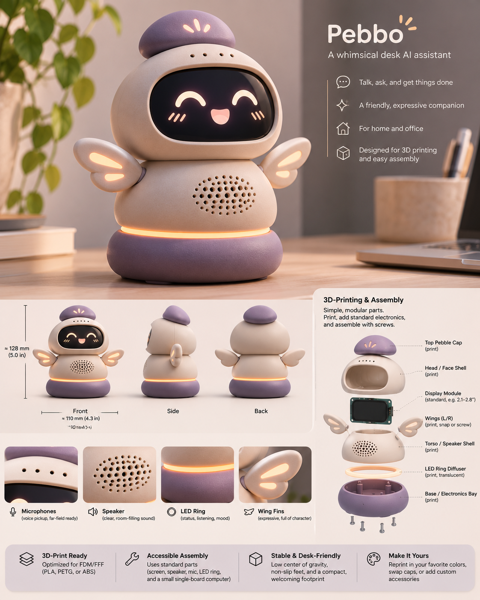

# Pebbo

A whimsical desk AI assistant: a small, expressive robot that talks, remembers and helps at home and in the office. Local first, self-hosted and open source.

## Status

**Alpha.** Pebbo is public early so that people and their agents can try it. It has not yet been tested on real hardware in everyday use, and anything may change until version 1 (see the [roadmap](docs/roadmap.md)).

Pebbo holds natural spoken conversations in German on a PC or in its own body, recognises household members by voice, remembers facts per person, speaks reminders on time and acts through tools it picks from the conversation. A second instance for the office and several compute devices are supported. Fully local. See [running Pebbo](docs/running.md), the [release notes](docs/release-notes.md) and the [roadmap](docs/roadmap.md).

## Highlights

- Hands-free conversation in German: "Hey Pebbo", speak, get an answer, interrupt naturally.
- Memory, reminders and routines per person, learned in plain language.
- Recognises household members by voice and treats unknown voices as guests.
- Local smart home and music through Home Assistant and Music Assistant.
- A home and an office Pebbo that exchange information only with approval.
- A phone app for chat, reminders and approvals, also away from home.
- Nothing leaves the house unless the owner turns it on.

## Documentation

| Document | Content |
| --- | --- |
| [Vision](docs/vision.md) | What Pebbo is, its personality and guiding principles |
| [Features](docs/features.md) | What each capability does and the rules it follows |
| [Architecture](docs/architecture.md) | Components, what runs where, data, security and network policy |
| [Decisions](docs/decisions.md) | What was decided and why |
| [Roadmap](docs/roadmap.md) | Phases and acceptance checks |
| [Research](docs/research.md) | Evaluated components and projects, open checks |
| [Running Pebbo](docs/running.md) | Setup, start, settings and measured response times |
| [Smart home and music](docs/smart-home.md) | Connecting Home Assistant and Music Assistant through MCP |
| [Development](docs/development.md) | Repository layout, setup, checks, network guard and dependency safety |
| [Third-party models](docs/third-party.md) | Models and voices with their licences and attribution |
| [Pebbo bodies](docs/devices.md) | Pairing and running an ESP32-S3-BOX-3 body |
| [Hardware](hardware/README.md) | Shopping list, printed case, firmware and assembly |
| [Office](docs/office.md) | A second instance with approved handoffs |
| [Compute devices](docs/compute.md) | Where the language model runs and the fallback |
| [Release notes](docs/release-notes.md) | What each release contains |

## Contributing

Read the [contribution guide](CONTRIBUTING.md), the [code of conduct](CODE_OF_CONDUCT.md) and the [security policy](SECURITY.md).

## Licence

Code is licensed under [Apache-2.0](LICENSE), hardware designs under [CERN-OHL-P v2](hardware/LICENSE) and documentation under [CC BY 4.0](docs/LICENSE).
