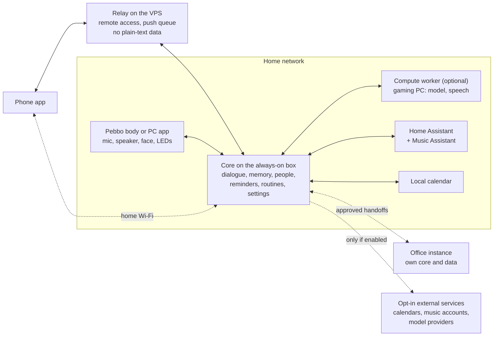
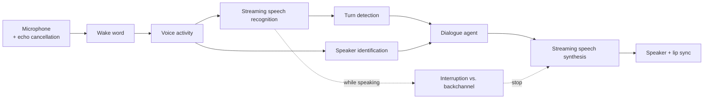

# Architecture

Status: target architecture before implementation. Component choices marked *to verify* in [research](research.md) may still change.

## Overview

A Pebbo instance consists of an always-on **core** at home, optional **compute workers**, one or more **bodies** (desk devices or the PC app), **phones**, and an optional **relay** on a VPS. A second instance (for example at the office) has its own core and talks to the first one only through approved handoffs.

## What runs where

| Component | Always-on box (about 150, N100 class) | Gaming PC worker (optional) | VPS relay (optional) | Body |
| --- | --- | --- | --- | --- |
| Microphone, speaker, wake word, face, LEDs | | Phase 1 test bench (PC app) | | Yes |
| Speech recognition and synthesis | Small models | Fast models on the GPU | | |
| Language model | Small fallback model | Main local model | | |
| Dialogue, memory, people, reminders, routines, settings | Yes, single source of truth | | | |
| Home Assistant, Music Assistant, local calendar | Yes | | | |
| Remote access and push queue | | | Encrypted only | |

During development everything runs on the gaming PC. The services that later move to the always-on box run in containers, so the move is a redeploy.

## Core components

| Component | Responsibility |
| --- | --- |
| **Session gateway** | Connects bodies, the PC app and phones. Streams audio in both directions and carries face, LED and control events. The PC app uses WebRTC, bodies the xiaozhi WebSocket protocol with Opus (see [Pebbo bodies](devices.md)). |
| **Voice pipeline** | Wake word, voice activity, turn detection, speech recognition, speaker identification, speech synthesis, interruption and backchannel handling. |
| **Dialogue agent** | Builds the prompt from personality, person, memory and context, calls the model router, executes tools and returns text with an emotion tag. |
| **Model router** | Chooses a model provider per request according to routing rules, availability and privacy class. Falls back when a worker is offline. |
| **Memory service** | Facts, preferences, conversation summaries, plans and lists per person, with origin and deletion. |
| **People and permissions** | Profiles, roles, voice fingerprints, guest mode, approvals and the audit log. |
| **Scheduler** | Reminders, routine triggers, proactive behaviour, quiet hours and rate limits. The reminder scheduler (`pebbo.reminders`) and the routine scheduler (`pebbo.routines.engine`) start with the core. |
| **Presence service** | Combines voice, home Wi-Fi and app signals into "near Pebbo", "home", "away" or "unknown" per person. Today only the voice (`pebbo.presence`), in memory, with arrive and leave events for routines. |
| **Delivery router** | Decides between speaking and pushing, escalates unacknowledged reminders. |
| **Routine engine** | Stores routines in Pebbo's own format, translates them to Home Assistant automations or runs them itself, logs each run. Today it runs them itself (`pebbo.routines`): taught through tools, confirmed by the person, device states through the `StateSource` protocol. See [routines](routines.md). |
| **Calendar** | Pebbo's own appointments per person or household and read-only ICS subscriptions from hosts the owner allowed (`pebbo.calendars`), feeding the context and the morning briefing (`pebbo.briefing`). |
| **Integrations** | Home Assistant, Music Assistant, calendars and optional providers, each as a connector that declares its actions, inputs, permissions and outbound hosts. MCP servers (`pebbo.tools.mcp`) are configured in the control centre; their tools are registered in the tool registry with the server's permission, and Home Assistant's device states feed the per-turn context. See [smart home and music](smart-home.md). |
| **Pairing service** | Short-lived codes for phones, bodies, compute workers and the second instance. Revocation takes effect immediately. |
| **Settings and app API** | Serves the phone app (`/api/app/`, see [phone app](phone.md)) and the settings pages. |

## Voice pipeline

- The pipeline is built on a voice agent framework (candidate: Pipecat) with local services: openWakeWord, Silero VAD, a turn detection model, faster-whisper on the GPU, and a German speech synthesis model.
- Speech recognition keeps running while Pebbo speaks. Short backchannels are ignored, stop words and real content interrupt.
- Each stage sits behind an interface, so a future full-duplex speech model can replace recognition, model and synthesis in one step.

## Data and separation

- **One SQLite database per instance** on the always-on box. Backups are encrypted. Feature modules such as routines and calendars keep their own tables in the same file (`Store.extension`).
- **Every record belongs to a person or to the household.** Queries are always scoped to the identified person, so personal data cannot leak into a guest or another person's answer.
- **Voice fingerprints** are numeric embeddings. Recordings are never stored.
- **Credentials** for integrations are encrypted at rest on the always-on box and never sent to the relay.
- **The relay** stores only encrypted push messages in transit and connection metadata.

## Security model

- **Pairing:** every phone, body, worker and second instance pairs with a short-lived, single-use code and gets its own revocable credential. A phone is bound to one person, and the core stores only a hash of its token (see [phone app](phone.md#pairing-a-phone)).
- **Approvals:** device actions marked as risky, messages to other people, routines affecting others and every handoff between instances need an explicit approval in the app.
- **Voice is not authentication:** voice identifies who is speaking for personalisation. Sensitive actions always need confirmation in the app.
- **Least privilege for integrations:** each connector declares the actions it can perform and the hosts it may contact. The core enforces both.
- **Who may connect:** the control centre and the PC app answer only on this computer, and only to pages whose Host and Origin name this computer, so a web page on another site cannot drive them through the owner's browser (cross-site requests, DNS rebinding). Bodies may connect from the home network and other instances from the home network or a private VPN; neither accepts requests from browser pages.
- **Audit log:** approvals, actions, routine runs and outbound requests are logged per instance.

## Network and outbound policy

- Bodies, workers and phones on the home network talk to the core directly. The core accepts the body endpoints (`/xiaozhi/`) and the phone app API (`/api/app/`) from private addresses, each with the device's own token. The control centre answers only on the computer the core runs on.
- Away from home, the phone reaches the core through the relay: a private WireGuard network coordinated by Headscale on the VPS, with the Tailscale client on the phone. The home router needs no open ports.
- **Push notifications:** the core encrypts each notification for the receiving phone. Only the phone can decrypt it (on iOS in a notification service extension). Delivery uses the platform push services: Apple Push Notification service on iOS, and UnifiedPush (for example with ntfy, self-hostable) or Firebase Cloud Messaging on Android.
- **Push gateway for the App Store app:** Apple only accepts pushes for an app signed with the publisher's key, so self-hosted Pebbos cannot reach the published iOS app directly. The project runs a small push gateway that forwards encrypted notifications to Apple, as Home Assistant and Nextcloud do for their apps. It sees only a device token and ciphertext, stores nothing and is open source. Self-hosters who build their own iOS app can use their own key instead.
- **Outbound allowlist:** the core and every component run with a deny-by-default outbound policy. Each enabled connector adds only its own hosts. The settings show every host contacted. Tests run with the network blocked.

## Technology stack

| Area | Choice | Licence |
| --- | --- | --- |
| Core service | Python with [FastAPI](https://github.com/fastapi/fastapi) | MIT |
| Voice pipeline | [Pipecat](https://github.com/pipecat-ai/pipecat) | BSD-2 |
| Dialogue agent | Pipecat context with a per-turn personal context, an action agent that picks tools from a registry with permissions after every sentence (decision 50), and tools from MCP servers as further tool sources | MIT |
| Phone apps (iOS and Android) | React Native with Expo: native stack navigation, Reanimated, Gesture Handler, SF Symbols, haptics, glass and blur effects, Tailwind-style styling for React Native. Builds through Codemagic. | MIT |
| PC app (face and voice) and web settings | TypeScript with React and Vite | MIT |
| Shared TypeScript packages | API contracts and client logic shared by the phone apps and the web app | |
| Face | A parametric face definition shared by the web renderer (SVG or canvas) and the device renderer (LVGL) | |
| Storage | SQLite per instance with sqlite-vec for memory search | Public domain, MIT or Apache-2.0 |
| Packaging | Docker Compose for the core, Home Assistant and Music Assistant, a simple installer for workers | |
| Quality | Type checks, tests without network access and continuous integration from the first commit | |

## Component map

What Pebbo reuses and what it builds itself.

| Purpose | Component | Status |
| --- | --- | --- |
| Smart home hub | [Home Assistant](https://github.com/home-assistant/core) (Apache-2.0), fully local, reached through its built-in MCP server | Decided, connected through MCP |
| Tools from MCP servers | Official [MCP Python SDK](https://github.com/modelcontextprotocol/python-sdk) (MIT), Streamable HTTP client, one session per call | Decided |
| Music (Spotify, YouTube Music, speakers) | [Music Assistant](https://github.com/music-assistant/server) (Apache-2.0), through its Home Assistant integration and Home Assistant's media tools | Decided, current provider status *to verify* |
| Own calendar | [Radicale](https://github.com/Kozea/Radicale) (GPL-3.0, separate process) | Decided |
| Remote access | [Headscale](https://github.com/juanfont/headscale) (BSD-3) on the VPS, Tailscale client on phones | Decided |
| Turn taking, interruptions, streaming | Pipecat with Silero VAD and Smart Turn | Decided |
| Wake word "Hey Pebbo" | [openWakeWord](https://github.com/dscripka/openWakeWord) (Apache-2.0) | Decided |
| Speech recognition | faster-whisper (MIT) | Decided, model size per device by benchmark |
| Speaker identification | CAM++ embeddings through [sherpa-onnx](https://github.com/k2-fsa/sherpa-onnx) (Apache-2.0) on the CPU | Decided, see decision 44 |
| German speech synthesis | [Pocket TTS](https://github.com/kyutai-labs/pocket-tts) (MIT, CC BY 4.0 weights), on the CPU | Decided, see decision 34 |
| Model runtime | [Ollama](https://github.com/ollama/ollama) (MIT), telemetry and cloud models off | Decided |
| Local model | Ministral 3 8B (Apache-2.0) through Ollama | Decided, see decision 33 |
| Always-on box | N100-class mini PC or Raspberry Pi 5 | Open, chosen by benchmark in phase 6 |
| Built by Pebbo | Dialogue agent, memory, people and voice onboarding, scheduler, presence, delivery router, routine engine, pairing, settings, phone app, face | |

### Optional subscription adapters

The agent talks to models through Pydantic AI, so any provider can be added as a model adapter. Subscriptions are reached the way [T3 Code](https://github.com/pingdotgg/t3code) does it: Pebbo never handles subscription tokens itself, it drives the official client that the person installed and signed in to on their own machine.

- **Codex subscription:** an adapter drives the official Codex app server, signed in with the person's ChatGPT account through `codex login` or OpenAI's "Sign in with ChatGPT" plan sharing. *to verify* that the terms cover a personal assistant.
- **Claude subscription:** an adapter runs the official Claude Code CLI in headless mode (`claude -p` with streaming JSON output), signed in through `claude auth login`. Anthropic's terms restrict subscription sign-ins to Claude Code and Claude.ai and forbid them in other tools and the Agent SDK. Driving the Claude Code CLI itself is how T3 Code works, but whether it is acceptable for an assistant is not confirmed. *to verify* Otherwise Claude works through an Anthropic API key, which Pydantic AI supports directly.
- **Limits of this path:** each request starts or reuses a separate CLI process, which adds seconds of latency. Subscription adapters are therefore meant for hard questions and longer tasks, not for the realtime conversation, which stays on the local model. While waiting, Pebbo says it needs a moment to think.
- **Rules:** off by default, one sign-in per person on that person's machine (usually as a paired compute worker), never shared with other household members, and the settings link to the provider's current terms.
