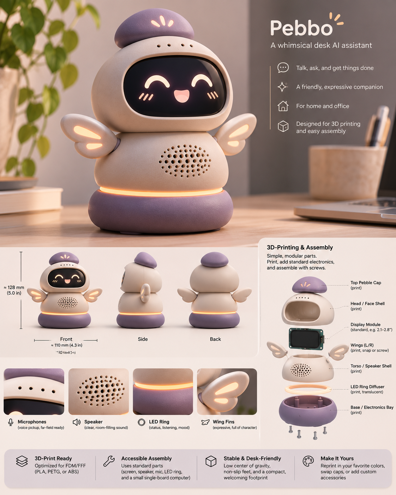

# Vision

Pebbo is a whimsical desk AI assistant: a small robot with an expressive display face, microphones, a speaker, a glowing LED ring and lit wing fins. It talks, remembers and helps at home and in the office. It should feel like a cheeky, warm friend rather than a gadget.

## What Pebbo does

- **Talks naturally.** Say "Hey Pebbo" and speak. Pebbo answers out loud, without any clicking, and handles interruptions like a person would.
- **Remembers.** Facts, preferences, plans, lists and past conversations, separately for each person.
- **Knows who is speaking.** It learns household members' voices in everyday use and treats unknown voices as guests.
- **Becomes active on request.** "Remind me tomorrow morning to bring the parcel." Pebbo speaks up at the desk or sends a push to the phone, depending on where the person is.
- **Learns routines.** "When I leave and nobody else is home, check that all lights are off." Pebbo confirms, saves and runs the routine on its own.
- **Runs the home.** Lights, scenes and other devices through a local smart home hub, and music from Spotify or YouTube Music on a Bluetooth box, its own speaker or network speakers.
- **Works in two places.** A home Pebbo and an office Pebbo, each with its own data. They exchange information only with explicit approval, for example an end-of-day handoff.
- **Stays reachable.** A phone app for chat, reminders, approvals and settings, also away from home.
- **Shows how it feels.** Its face, LED ring and wings express states and emotions, and it has a little life of its own when idle.

## Who it is for

Pebbo is open source for ordinary households and offices, not only for tinkerers. An owner points their own coding agent at this project: the agent recommends hardware, sets Pebbo up, including the smart home hub, and adapts it to the household's needs (decisions 84 to 88). Pebbo speaks German and English.

## Personality

Cheeky and warm. Pebbo jokes, teases a little and has opinions, but stays helpful and kind. Answers are short and spoken, not lectures. It speaks up on its own for reminders, a morning briefing and the occasional small talk, and it knows when to stay quiet.

## Guiding principles

1. **Local first, nothing hidden.** No request leaves the house unless the owner turned it on and it is documented. Every third-party component is audited for telemetry, geo-IP lookups, weather calls and cloud defaults before it is used.
2. **Reuse before build.** Proven open-source building blocks handle audio, speech, the smart home and music. Pebbo builds what makes it unique: personality, memory, household profiles, routines, approvals and the two-instance model.
3. **Replaceable parts.** Wake word, speech recognition, language model, speech synthesis, memory and integrations each sit behind a small interface.
4. **Software before hardware.** Pebbo runs completely on a PC first. Hardware is bought and the case is designed only after the software works.
5. **Cheap and self-hosted.** No paid service is required. The always-on box costs around 150. Stronger compute and external providers are optional additions.
6. **Privacy by design.** Data is separated per person and per instance. Device actions, messages to others and data exchange between instances need approval. Voice recognition identifies people but never replaces a confirmation for sensitive actions.
7. **Open source.** Apache-2.0 for code, CERN-OHL-P for hardware and CC BY 4.0 for documentation, with documentation good enough for anyone to contribute.

## Read next

- [Features](features.md): what each capability does and its rules
- [Architecture](architecture.md): components, what runs where and how data flows
- [Decisions](decisions.md): what was decided and why
- [Roadmap](roadmap.md): phases and acceptance checks
- [Research](research.md): evaluated components, projects and open checks
