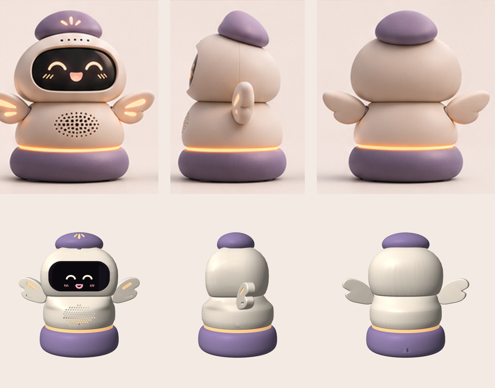

# Pebbo hardware

Pebbo's body: an Espressif ESP32-S3-BOX-3 in a 3D-printed case shaped after the [concept image](../lieferung-fm/), a warm LED ring, glowing wings and a glowing cap. The body is a thin client: it streams sound to the Pebbo core on the home network and plays Pebbo's voice. Everything else runs in the core. Hardware designs are licensed under [CERN-OHL-P v2](LICENSE).



Top row: the concept. Bottom row: the printed case from the same sides (rendered from the STL files).

| Folder | Contents |
| --- | --- |
| [case/](case/) | Parametric case (`pebbo_case.py`, build123d), STL files in `case/print/` (STEP files are written there by the script), a fit check and preview renders |
| [firmware/](firmware/) | Pebbo's board code for the open [xiaozhi-esp32](https://github.com/78/xiaozhi-esp32) firmware and a build script |

Setting up a body (flashing, Wi-Fi, pairing) is described in [docs/devices.md](../docs/devices.md).

## Why these parts

- **ESP32-S3-BOX-3** (Espressif): display, two microphones, speaker, mute button and, most importantly, echo cancellation on the device with a hardware loopback. Pebbo can listen while it speaks, so it can be interrupted. It is the reference board of the xiaozhi firmware and needs no soldering. Its glass, speaker box and microphone covers are glued in and tuned by Espressif, so the case is built around the closed unit.
- **BOX-3 BRACKET** (in the standard kit): the BOX-3 plugs into it, and it gives power and a free GPIO on its PMOD header for the lights.
- **WS2812B lights**: a 24-LED ring in the base, one LED in each wing and one under the cap, all on one data line.

Because the BOX-3 (66 x 61 mm) is taller than the display in the concept, the whole case keeps the concept's proportions at 1.3 times its size: about 175 mm tall, the head 114 mm wide.

## Shopping list (Switzerland, prices checked on 2026-11-20)

| Part | Qty | About CHF | Where | Notes |
| --- | --- | --- | --- | --- |
| Espressif ESP32-S3-BOX-3 (standard kit, includes the BRACKET) | 1 | 47 | [Mouser CH](https://www.mouser.ch/c/?q=ESP32-S3-BOX-3) (part 356-ESP32-S3-BOX-3) | Not the BOX-3B: it lacks the BRACKET |
| WS2812B ring, 24 LEDs, 65.5 mm outside, 52.3 mm inside | 1 | 18 to 27 | [Bastelgarage](https://www.bastelgarage.ch) ring set, or Adafruit 1586 at [Digitec](https://www.digitec.ch) | Other rings fit if they are about 66 mm across, see `LED_RING_*` in `pebbo_case.py` |
| WS2812B single LED on a round 10 mm board | 3 | 3 | Bastelgarage | Two wings and the cap |
| USB-C power supply, 5 V 3 A (for example Apple 20 W) | 1 | 20 | Digitec | The BOX-3 needs 5 V 2 A, the lights up to 0.3 A at Pebbo's brightness |
| USB-C socket breakout with screw terminals | 1 | 4 | Bastelgarage or AliExpress | Sits in the back of the base: 5 V in |
| USB-C plug with open wires (or a short USB-C cable cut in half) | 1 | 5 | Bastelgarage or AliExpress | Feeds the BRACKET from the breakout |
| M3 heat-set inserts (4.2 mm hole) | 11 | 15 (set) | Bastelgarage insert set | 3 in the torso bottom, 2 to 4 on the bracket shelf, 4 in the head floor |
| M3 screws: 3 x M3x40, 4 x M3x8, 2 x M3x8 (bracket), 2 x M3x12 (as dowels) | 11 | 15 (assortment) | Bastelgarage | Low or countersunk heads for the base |
| Silicone wire 3-core 26 AWG, about 1 m, and 4 female jumper wires | 1 | 10 | Bastelgarage | Light chain and the data line to the PMOD header |
| Rubber feet, 10 mm round | 4 | 5 | Any | |
| Filament PLA matte, ivory or cream | 1 kg | 20 | Digitec | Head, torso, wings |
| Filament PLA matte, lavender | 1 kg | 20 | Digitec | Base, cap, mute plunger |
| Filament PETG translucent or "natural" | 1 kg | 20 | Digitec | Glowing ring, wing and cap inlays |
| Filament PLA matte black | 1 kg | 20 | Digitec | Visor |
| **Total body** | | **about 225 to 235** | | Without a printer. Filament is enough for several Pebbos. |
| 3D printer Bambu Lab A1 mini (optional) | 1 | 186 | Digitec | Every part fits its 180 mm bed. Run it in LAN-only mode. Cheaper than three or four print-service orders for a prototype. |

The brain (the computer that runs speech recognition, the language model and the voice) is covered in [docs/devices.md](../docs/devices.md#what-runs-pebbo).

## Printing

All parts print without glue sticks or brims on a textured PEI plate. 0.2 mm layers, 3 walls, 15 % gyroid infill.

| Part (case/print/) | Filament | Orientation | Supports |
| --- | --- | --- | --- |
| `base` | lavender | upright, flat bottom down | none |
| `ring` | translucent PETG | flat | none |
| `torso` | cream | upright | tree supports for the wing sockets only |
| `head_front` | cream | split face down | tree supports inside the visor opening |
| `head_back` | cream | split face down | none |
| `visor` | black | glass side down | none |
| `cap` | lavender | upright | tree supports under the floor |
| `cap_light` | translucent PETG | upright | none |
| `mute_plunger` | lavender | standing | none |
| `wing_left`, `wing_right` | cream | front down | tree supports |
| `wing_cover_left`, `wing_cover_right` | cream | flat side down | none |
| `wing_glow_left`, `wing_glow_right` | translucent PETG | flat | none |

To change a size, edit the constants at the top of [case/pebbo_case.py](case/pebbo_case.py) and run:

```sh
cd hardware/case
uv run --with build123d python pebbo_case.py      # writes print/*.stl and *.step
uv run --with build123d python check_fit.py       # no part may overlap another or the BOX-3
uv run --with vtk --with pillow --with build123d python render.py   # preview images
```

`check_fit.py` places the BOX-3, its bracket and the LED ring and fails if anything collides. The BOX-3 position is computed: as far forward as the head allows, so its screen sits close to the visor. Seen from 30 degrees above, nothing of the screen is hidden. From 38 degrees (a seated person at a desk), about 2 mm are.

## Assembly

1. **Inserts.** Press M3 heat-set inserts into the three holes under the torso, into the bracket shelf in the torso (two of the four, the ones that line up with the bracket's holes) and into the four floor bosses of the head halves.
2. **Base.** Lay the LED ring on the three pillars, LEDs up. Glue the USB-C breakout into the slot at the back. Wire the breakout's 5 V and GND to the ring's 5 V and GND, and to the USB-C plug for the bracket.
3. **Lights.** Solder three wires to each single LED. Chain them: ring DOUT to the left wing's DIN, its DOUT to the right wing, then to the cap. Run the ring's DIN with a jumper wire up through the middle of the glowing ring to the bracket's PMOD header, pin IO39.
4. **Torso.** Screw the bracket onto the shelf from below the torso opening. Plug the USB-C plug into the bracket. Push the glowing ring onto the base and fasten the torso with three M3x40 screws from under the base.
5. **Wings.** Press the glow inlays into the slots from behind, lay each LED into its wing cover, thread the wires through the peg and glue the cover in. Glue the pegs into the torso's sockets.
6. **BOX-3.** Plug the BOX-3 into the bracket through the torso top.
7. **Head.** Glue the visor into the front half. Put the mute plunger into its guide from inside, the flange under the guide, with the cap LED's wires through it. Put the two head halves together around the BOX-3 with two M3x12 screws as dowels, and screw them to the torso with four M3x8 screws from inside the torso. Glue the cap light into the cap, the LED into its pocket, and glue the cap onto the plunger with its two pins in the guide holes.

Pressing the cap now presses the BOX-3's mute button: the microphones are off and Pebbo cannot hear anything.

## Measurements of the bought parts

From Espressif's STEP files ([esp-box repository](https://github.com/espressif/esp-box/tree/master/hardware/esp32_s3_box_3_shell)) and drawings:

| Part | Value |
| --- | --- |
| BOX-3 main unit | 66.0 x 61.0 x 16.6 mm, microphone ports 2 x Ø1.8 mm at ±17 mm, 5.5 mm below the top on the front, speaker on the right side, mute button on top |
| BOX-3 BRACKET | 70.5 x 22.5 x 18.8 mm. The BOX-3 sits 1.8 mm deep in a pocket that is almost centred (2.0 and 3.5 mm walls front and back). Two vertical M3 holes, 60 mm apart, 6.5 mm off the middle |
| LED ring | 65.5 mm outside, 52.3 mm inside, 3.2 mm thick |

Still to check on the real parts before the final print: which face of the bracket is the front (the shelf has inserts for both), and the exact ring size of the ring you buy.
